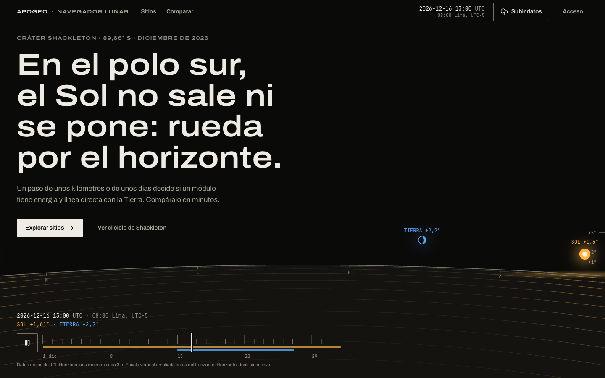
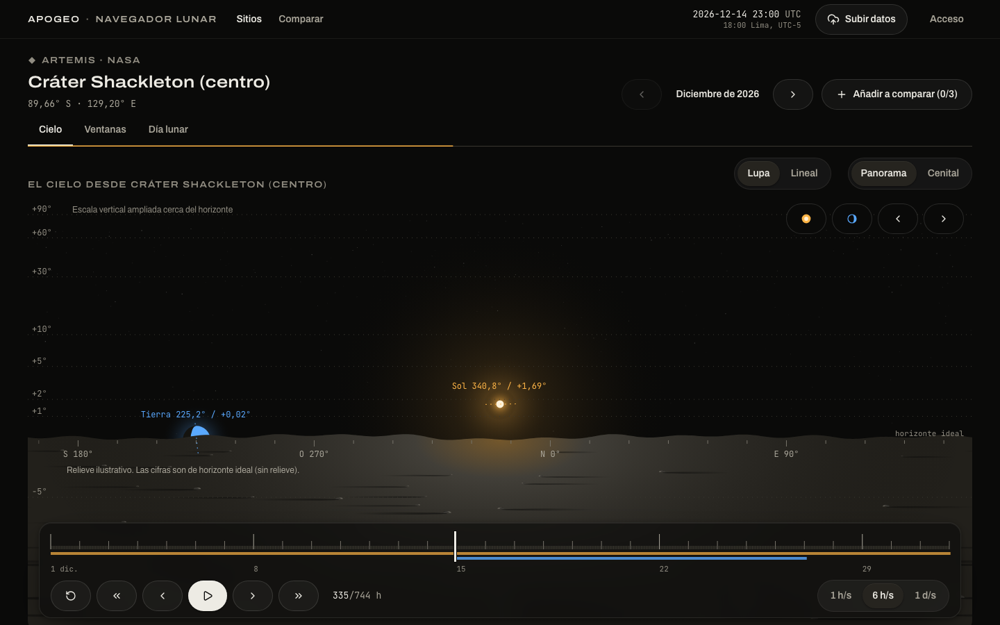
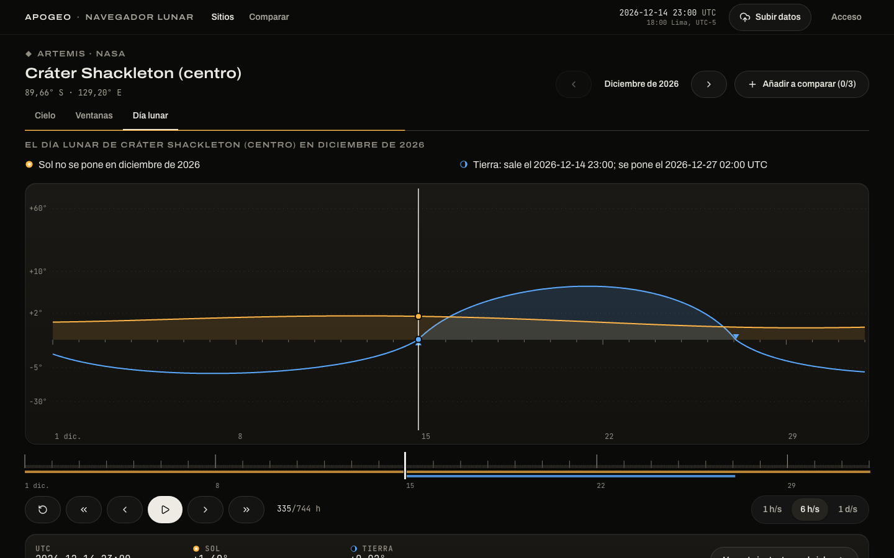

# Apogeo Navigator · Frontend

**Mira dónde están el Sol y la Tierra sobre el horizonte de cualquier sitio de alunizaje lunar.**
Interfaz web de *Lunar Landing Site Navigator*, el proyecto del equipo Apogeo para el NASA Space Apps Challenge 2026 ([reto](https://www.spaceappschallenge.org/2026/challenges/lunar-landing-site-navigator/)).



- **Aplicación en producción:** https://apogeo-514716.web.app
- **Repositorio del backend:** https://github.com/ACHAVESTA-Git/ApogeoNavigator-Backend
- La interfaz está en **español** y tiene selector **ES/EN** (ver «Idioma»). Hay un resumen en inglés al final.

## Qué hace
Eliges un sitio lunar y un periodo, y la app muestra desde su horizonte dónde están el Sol y la Tierra, hora a hora, y qué significa eso para un módulo de alunizaje:

- **Horas de Sol** (energía) y **horas de línea directa con la Tierra** (comunicaciones).
- **Tiempo hasta la próxima puesta** del Sol y de la Tierra.
- Un **semáforo** de energía y comunicación, con la razón en palabras y una forma distinta por nivel (no solo color).
- Un aviso de **sensibilidad al relieve** cuando el Sol no supera los 3° sobre el horizonte ideal.
- **Comparación** de sitios y de fechas, y un **ranking Top 5** de dónde conviene alunizar.
- **Carga de CSV** validada por el backend antes de guardar.

Todas las cifras suponen un **horizonte ideal** (Luna lisa, sin relieve) y la app lo avisa junto a cada resultado.

## Pantallas
Las rutas están en `src/routes/` y se cargan de forma diferida (el JS inicial solo lleva el layout y el Inicio).

| Pantalla | Ruta | Qué hace |
|---|---|---|
| **Inicio** inmersivo | `/` | Relato en actos sobre el cielo real de Shackleton, con cifras leídas de los datos, el recorrido «Tres pasos para decidir» (Cielo, Comparar, Análisis), por qué el polo es extremo, glosario y fuentes de datos. |
| **Sitios** | `/sitios` | Mapa polar y catálogo de sitios, filtrables por categoría. |
| **Cielo** | `/sitios/:id/cielo` | Azimut y elevación del Sol y la Tierra vistos desde el sitio, con escena a pantalla completa y panel de lectura (UTC, hora local, si cada astro está sobre el horizonte y cuándo se pone). |
| **Ventanas** de luz | `/sitios/:id/ventanas` | Barras hora a hora de cuándo hay Sol y Tierra, métricas con su significado y el semáforo. |
| **Día lunar** | `/sitios/:id/dia-lunar` | Elevación del Sol y de la Tierra en el periodo, con el horizonte como eje cero y marcas en cada salida y puesta. |
| **Análisis** | `/sitios/:id/analisis` | Transparencia del análisis: el camino de cada cifra, del archivo CSV al gráfico, con huellas y firma del manifiesto. |
| **Proyección** (solo administración) | `/sitios/:id/proyeccion` | Valores proyectados por un modelo estadístico hasta 2028, siempre rotulados como proyección y no como efeméride. Se muestran con el error medido al compararlos con JPL Horizons. Sin rol de administración la pestaña pide iniciar sesión y no solicita ningún dato. |
| **Ventana de alunizaje** | `/sitios/:id/ventana` | «¿Cuándo alunizar?»: según la duración de la estancia (3, 6,5 o 14 días) calcula la mejor ventana con Sol y Tierra a la vez y la muestra en un calendario de calor sobre los seis meses de datos. |
| **Comparar** | `/comparar` | Dos o tres sitios en un mismo mes, o un sitio en distintos meses, con filas de horizonte, tabla comparativa, un único control de tiempo y un veredicto en una frase. Incluye el **Top 5** de sitios (orden: primero el veredicto de energía y comunicación; a igualdad, más horas seguidas con Sol y Tierra a la vez). El estado va en la URL. |
| **Subir datos** | botón en la cabecera | Popup donde se sueltan archivos CSV (`sites`, `metricas`, `efemerides_<sitio>`); el backend los valida y muestra una tabla de errores por fila y columna antes de guardar. |
| **Acceso** | `/acceso` | Inicio de sesión con **correo y contraseña**. La sesión vive en una cookie que el código de la página no puede leer. La app pública es de solo lectura y no necesita cuenta. |
| **Perfil** | `/perfil` | Quién eres, tu rol (analista, revisor o administración) y las huellas públicas de tus claves post-cuánticas. Nunca muestra material privado. |
| **Gestor de claves** | `/admin/claves` | Solo para el rol de administración: listar, generar, rotar y revocar claves por usuario. |

También hay coordenadas propias (`punto_…`): el Cielo y las Ventanas pueden consultar en vivo un punto arbitrario a través del backend (`/api/horizons`, máximo 35 días por consulta).






## Idioma
La configuración (botón «Configuración» de la cabecera) permite elegir **Español** o **English**. Las fechas y las cifras siguen el idioma elegido y la página se recarga al cambiarlo. La preferencia se guarda en el navegador; si el navegador no deja guardarla, el selector lo avisa. Los textos están en `src/lib/textos.es.ts` y `src/lib/textos.en.ts` (toda clave nueva va en los dos). Los nombres de los sitios, sus notas y los pasos del análisis vienen del conjunto de datos y se muestran en español en los dos idiomas.

## Ejecutar en local
Necesitas Node.js y el backend en marcha. En dos terminales:

```bash
# Terminal 1 · backend (ver su README)
git clone https://github.com/ACHAVESTA-Git/ApogeoNavigator-Backend && cd ApogeoNavigator-Backend
python3 -m venv .venv && source .venv/bin/activate
pip install -r requirements-dev.txt
DATA_DIR=data uvicorn app.main:app --port 8080       # documentación de la API: http://localhost:8080/docs

# Terminal 2 · frontend
git clone https://github.com/ACHAVESTA-Git/ApogeoNavigator-Frontend && cd ApogeoNavigator-Frontend
npm ci
npm run dev                                           # http://localhost:5173 (/api se reenvía a http://localhost:8080)
```

### Scripts (`package.json`)
| Comando | Qué hace |
|---|---|
| `npm run dev` | Servidor de desarrollo de Vite. |
| `npm run build` | Comprueba el contraste de la paleta (`scripts/contraste.mjs`), verifica los tipos (`tsc -b`) y genera el build de producción. |
| `npm run preview` | Sirve el build generado. |
| `npm test` | Vitest en modo interactivo. |
| `npm run test:run` | Vitest, una sola ejecución (pruebas con Testing Library y jsdom). |
| `npm run contraste` | Solo la comprobación de contraste de la paleta. |
| `npm run datos:muestra` | Regenera los datos de muestra incluidos. |

**¿Sin backend?** Con `VITE_USE_SAMPLE_DATA=auto` (el valor por defecto) la app usa los datos de muestra de `public/muestra/` cuando la API no responde, y avisa con un banner.

## Configuración
Copia `.env.example` a `.env` y edítalo. Todas las variables `VITE_*` son **públicas** (acaban en el navegador): nunca pongas secretos aquí.

| Variable | Valor por defecto | Significado |
|---|---|---|
| `VITE_API_BASE_URL` | vacía | Base de la API, **sin barra final**. Vacía significa el mismo origen (llamadas relativas `/api/...`): así funciona en producción, donde Firebase Hosting reenvía `/api/**` al backend mediante un *rewrite*, y en local mediante el proxy de Vite. Solo hay que rellenarla si la API está en otro origen (por ejemplo `https://tu-api.example.com`); entonces el backend debe permitir ese origen con CORS. |
| `VITE_USE_SAMPLE_DATA` | `auto` | `auto`: usa la API y recurre a la muestra solo si no responde; `true`: siempre la muestra; `false`: solo la API. |
| `VITE_API_TARGET` | `http://localhost:8080` | Solo para `npm run dev` y `npm run preview`: adónde se reenvía `/api`. |

Vite lee estas variables al compilar: si las cambias, vuelve a compilar.

## Pruebas y build
```bash
npm run test:run    # Vitest
npm run build       # contraste + tipos + build de producción (carpeta dist/)
```
Las pruebas viven junto al código (`*.test.ts` y `*.test.tsx`). Los resultados de la verificación y las capturas están en [`docs/verificacion.md`](docs/verificacion.md) y `docs/frontend/capturas/`.

## Tecnología
React 18 · Vite · TypeScript · Tailwind CSS 4 · TanStack Query · React Router 7 · d3-scale y d3-shape (gráficos) · Motion (animación) · Vitest y Testing Library. Tipografías Archivo y JetBrains Mono (SIL Open Font License) mediante Fontsource. Estructura: `src/routes` (pantallas), `src/components`, `src/hooks`, `src/lib` (cliente de la API, cálculos astronómicos, constantes en `constants.ts` y textos de la interfaz). El repositorio incluye un `Dockerfile` con nginx para uso local.

## Datos NASA y fuentes
La posición del Sol y de la Tierra (azimut y elevación, hora a hora, vistos desde cada sitio lunar) procede de **NASA/JPL Horizons** ([sistema](https://ssd.jpl.nasa.gov/horizons/), [API](https://ssd-api.jpl.nasa.gov/doc/horizons.html)). Las coordenadas de los sitios vienen de **NSSDC** (sitios Apolo), **LROC** (Shackleton y alunizajes recientes) y **NASA/LRO** (IM-1 Odysseus). Los archivos de datos y sus fuentes están en el [repositorio del backend](https://github.com/ACHAVESTA-Git/ApogeoNavigator-Backend). Las proyecciones del modelo, los umbrales del semáforo y el relieve ilustrativo **no** son datos de la NASA y están marcados como tales en la interfaz.

## Insignias de misión (Apolo 11, 15 y 17)
Los sitios de Apolo 11, 15 y 17 muestran la insignia auténtica de su misión, sin recortar ni recolorear, tomada de la NASA Image and Video Library, con el crédito **«Imagen: NASA»** y la nota «La NASA no avala este proyecto». Es un uso informativo y educativo, **sin aval ni aprobación escrita de la NASA**; si la NASA lo pide, se retiran. Los demás sitios usan un monograma neutro generado en código. Fuentes, condiciones y riesgo asumido: [`public/insignias/README.md`](public/insignias/README.md).

## Limitaciones
- **Horizonte ideal:** sin relieve. Una colina real puede tapar el Sol o la Tierra.
- **Datos de efemérides acotados** a un periodo de seis meses y a los sitios del catálogo; fuera de él la API responde 422 y la interfaz lo muestra como estado vacío.
- **Umbrales del semáforo provisionales:** son criterio de ingeniería del equipo, no requisitos de misión.
- **La proyección** es un modelo estadístico, no una efeméride, y solo la ve la administración.

## Contribuir
Lee [CONTRIBUTING.md](CONTRIBUTING.md): ramas, commits con el ID de la historia de usuario y Pull Requests.

## Licencia
[MIT](LICENSE) © 2026 Apogeo Team. La NASA no avala ni patrocina este proyecto; los nombres y datos de la NASA se usan solo para identificar sus fuentes.

---

## Summary in English
**Apogeo Navigator** shows where the Sun and the Earth sit on the horizon of a lunar landing site, hour by hour, and turns it into hours of sunlight, hours of direct line of sight to Earth, time to sunset and a viability traffic light. Screens: immersive Home, Sites, Sky, Light windows, Lunar day, Analysis, Landing window, Compare (Top 5, sites and dates), Data upload, Sign-in (email and password), Profile, Key manager and an admin-only Projection tab. The interface has an ES/EN selector. Live app: https://apogeo-514716.web.app. Run: `npm ci`, `npm run dev` with the backend on port 8080; `VITE_API_BASE_URL` is empty in production because Firebase Hosting rewrites `/api/**`. Sun and Earth positions come from NASA/JPL Horizons; NASA does not endorse this project. License: MIT.
