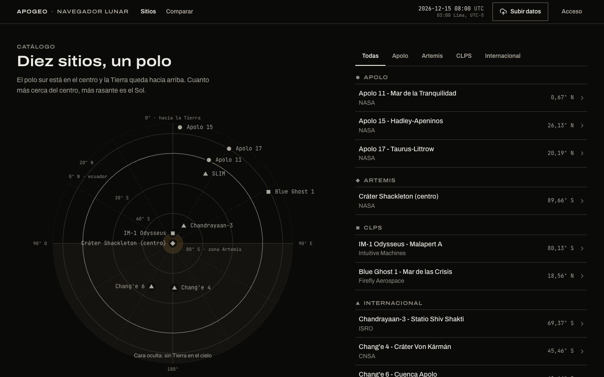
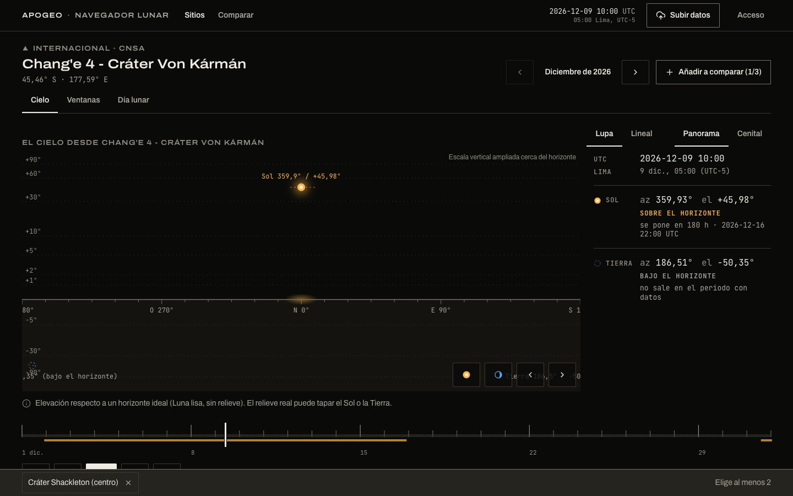

# Apogeo Navigator · Frontend

**See where the Sun and the Earth sit on the horizon of any lunar landing site.**
Web interface of *Lunar Landing Site Navigator*, our project for the NASA Space Apps Challenge 2026 (challenge: [Lunar Landing Site Navigator](https://www.spaceappschallenge.org/2026/challenges/lunar-landing-site-navigator/)).


> **Language note:** the interface is currently in **Spanish**. This README is in English; a short Spanish summary is at the end (*Resumen en español*).
> **Backend repository:** https://github.com/ACHAVESTA-Git/ApogeoNavigator-Backend
<!-- TODO before submitting: add the live demo URL and the demo video URL here. -->

## What it does
Pick a lunar site and a month and the app shows, from that site's horizon, where the Sun and the Earth are, hour by hour, and what that means for a lander:

- **Hours of sunlight** (energy) and **hours of direct line of sight to Earth** (communications).
- **Time until the next sunset and the next Earthset.**
- A **traffic light** for energy and communications, with the reason in words and a shape (not only a colour).
- A **"terrain-sensitive" warning** when the Sun never rises above 3° (a nearby hill could hide it).
- **Comparison** of two or three sites, or of the same site in different months.
- **CSV upload** for analysts, validated by the backend before anything is saved.

## Why it matters
At the lunar south pole the Sun does not rise and set: it rolls along the horizon. A small change of place or date can leave a lander without power or without a direct link to Earth. With real [JPL Horizons](https://ssd.jpl.nasa.gov/horizons/) data for ten locations over six months (December 2026 to May 2027, hourly), for example:

| Site (December 2026) | Maximum Sun elevation | Earth above the horizon |
|---|---|---|
| Apollo 11 | 88.1° | 100% |
| Shackleton crater (centre) | 1.7° | 39% |
| Chang'e 4 (far side) | 46.0° | **0%** (a relay such as Queqiao is needed) |

All figures assume an **ideal horizon** (a smooth Moon, no terrain). Shackleton's centre shows 100% Sun in December, but the real crater floor is in permanent shadow: that number is an artefact of the smooth-sphere model, and the app says so next to each result. Data and queries: [`docs/datos/informe-fuentes.md`](https://github.com/ACHAVESTA-Git/ApogeoNavigator-Backend/blob/dev/docs/datos/informe-fuentes.md) in the backend repository.

## The concept: "Rasante" (grazing)
Everything that matters for choosing a site happens **on the horizon**: is the Sun above it, and by how much? Is the Earth above it? How long until one of them crosses it? So the interface is built around **one line, the horizon**, which persists between screens and changes shape: the lunar limb on the home page, the concentric rings of the polar map, the zero-degree axis of the sky, the base of the light bars. The palette is nearly monochrome (regolith greys) with only two lights in colour: the **Sun in amber** and the **Earth in blue**. The vertical scale of the sky is **magnified near the horizon**, because at the poles both bodies live within a few degrees of it.

## Screens
**Home.** The real December 2026 sky above Shackleton crater, with a timeline you can play.

**Sites.** Ten sites placed around the south pole by latitude (the closer to the centre, the more grazing the Sun), filterable by category: Apollo, Artemis, CLPS and international missions.



**Site → Sky.** The sky seen from the site, with four views: magnifier, linear, panorama and zenithal. The reading panel gives azimuth and elevation, UTC and local time, whether each body is above the horizon, and when it will set.


At Chang'e 4, on the far side, the Earth never leaves the lower half of the sky:



**Site → Light windows.** A bar for every hour of the period showing when the Sun and the Earth are up, plus the metrics and the traffic light.

**Compare.** Two or three sites in the same month, or one site in different months, with horizon rows, a comparison table, a shared time cursor and a one-sentence verdict. The state is kept in the URL (`/comparar?s=shackleton,apollo11,change4`).

**Upload data** (button in the header). A pop-up where analysts enter the upload key, drop CSV files and see each one validated by the backend, with a table of errors by row and column, before saving.

<!-- TODO: add screenshots of Compare, Light windows and the Upload pop-up (the existing captures predate those screens). -->

## Run it locally
You need Node.js and the backend running. **Without Docker**, in two terminals:

```bash
# Terminal 1 · backend (see its README for details)
git clone https://github.com/ACHAVESTA-Git/ApogeoNavigator-Backend && cd ApogeoNavigator-Backend
python3 -m venv .venv && source .venv/bin/activate
pip install -r requirements-dev.txt
DATA_DIR=data uvicorn app.main:app --port 8080       # API docs: http://localhost:8080/docs

# Terminal 2 · frontend
git clone https://github.com/ACHAVESTA-Git/ApogeoNavigator-Frontend && cd ApogeoNavigator-Frontend
npm install
npm run dev                                           # http://localhost:5173 (/api is proxied to http://localhost:8080)
```

Other scripts: `npm run build` (type-check and production build), `npm run preview`, `npm run test:run` (Vitest, single run) and `npm run datos:muestra` (regenerates the bundled sample data).

**No backend?** With `VITE_USE_SAMPLE_DATA=auto` (the default) the app falls back to bundled sample data (`public/muestra/`) when the API does not respond, so you can still explore it.

## Configuration
Copy `.env.example` to `.env` and edit. Every `VITE_*` variable is **public** (it ends up in the browser): never put secrets here. The upload key is typed in the upload pop-up and is never stored in the repository.

| Variable | Default | Meaning |
|---|---|---|
| `VITE_API_BASE_URL` | empty | Base URL of the API, **without a trailing slash**. Empty means the same origin (relative `/api/...` calls, as in local development through the proxy). For a deployment on another origin, e.g. static hosting plus a separate API: `https://your-api.example.com`. The backend must then allow your origin with `CORS_ORIGINS` or `CORS_ORIGIN_REGEX`. |
| `VITE_USE_SAMPLE_DATA` | `auto` | `auto`: use the API and fall back to sample data only if it does not respond; `true`: always sample data; `false`: API only. |
| `VITE_API_TARGET` | `http://localhost:8080` | Only for `npm run dev`: where the dev server proxies `/api`. |

Vite reads these at build time: change them and rebuild.

## Tech stack
React 18 · Vite · TypeScript · Tailwind CSS 4 · TanStack Query · React Router 7 · d3-scale and d3-shape (charts) · Motion (animation) · Vitest and Testing Library · Docker/nginx image for local use. Fonts: Archivo and JetBrains Mono (SIL Open Font License), via Fontsource. Source layout: `src/routes` (screens), `src/components`, `src/hooks`, `src/lib` (API client, astronomy helpers, constants, all interface texts in `textos.ts`).

## NASA data and sources
All sunlight and Earth-visibility figures come from **NASA/JPL Horizons** ([system](https://ssd.jpl.nasa.gov/horizons/), [API](https://ssd-api.jpl.nasa.gov/doc/horizons.html)): hourly apparent azimuth and elevation of the Sun and the Earth seen from ten locations on the Moon, 2026-12-01 to 2027-06-01 (ephemerides DE441, observer `coord@301`, no refraction). Site coordinates come from the **NSSDC** ([lunar landing sites](https://nssdc.gsfc.nasa.gov/planetary/lunar/lunar_sites.html): Apollo 11, 15, 17), **LROC** (Shackleton, Blue Ghost 1, Chandrayaan-3, Chang'e 4 and 6, SLIM) and **NASA/LRO** (IM-1 Odysseus). The data files and their sources live in the [backend repository](https://github.com/ACHAVESTA-Git/ApogeoNavigator-Backend). Moon Trek, QuickMap and the PGDA products were consulted but **not used as data**.

## Limitations
- **Ideal horizon:** no terrain. Real horizons from LOLA are future work.
- **Six months** of ephemerides (not a full year) and ten locations. Artemis III candidate regions are not included because NASA has not published their coordinates.
- **Viability thresholds** (energy green ≥ 45%, yellow 25% to < 45%, red < 25%; communications green ≥ 70%, yellow 40% to < 70%, red < 40%) are provisional engineering judgement, not mission requirements.
- The interface is in Spanish only for now.

## Use of AI
This project was built with AI agents: Anthropic's Claude models, used through the Claude Code command-line tool in parallel sessions, coordinated and reviewed by the project owner.
<!-- {{PENDING owner confirmation before publishing: complete this declaration with the text approved in docs/entrega/formulario-en.md, section 6 "Use of Super Intelligence (SI)": what AI generated or assisted (code, tests, data scripts, documentation, design, review), what the owner decided, the model list, and who conceived the idea of the solution.}} -->
No NASA logos, flags or mission identifiers were used or generated.

## Contributing
Read [CONTRIBUTING.md](CONTRIBUTING.md): branches, commits with the user-story ID and pull requests.

## License
[MIT](LICENSE) © 2026 Apogeo Team. NASA does not endorse or sponsor this project; NASA names and data are used only to identify their sources.

---

## Resumen en español
**Apogeo Navigator** muestra dónde están el Sol y la Tierra sobre el horizonte de un sitio de alunizaje lunar, hora por hora, y lo traduce en horas de energía, horas de enlace directo con la Tierra, tiempo hasta las puestas y un semáforo de viabilidad. Usa datos reales de **NASA/JPL Horizons** para diez ubicaciones durante seis meses (diciembre de 2026 a mayo de 2027). Permite comparar sitios y fechas y subir CSV que el backend valida. El concepto de diseño, «Rasante», convierte la línea del horizonte en la interfaz.

**Ejecutar:** `npm install` y `npm run dev` con el backend en el puerto 8080 (ver «Run it locally»). **Configuración:** `VITE_API_BASE_URL` (vacía = mismo origen), `VITE_USE_SAMPLE_DATA` y `VITE_API_TARGET`. **Límites:** horizonte ideal (sin relieve), seis meses, umbrales provisionales. **Datos:** JPL Horizons, NSSDC, LROC y NASA/LRO; la NASA no respalda este proyecto. **Licencia:** MIT.
