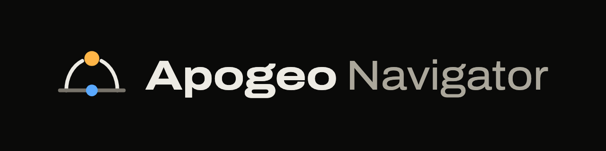

# Marca · Apogeo Navigator

Identidad de la aplicación dentro del concepto «Rasante» (`plan-diseno.md`): una línea de horizonte, el Sol y la Tierra.

## Logo

| Variante | Archivo | Uso |
|---|---|---|
| Completa | `src/components/marca/Logo.tsx` (símbolo en línea y texto vivo) · `public/marca/logo.png` | Cabecera y pie del inicio |
| Completa, monocroma | `Logo` con `mono` · `public/marca/logo-mono.png` (fondo transparente) | Sobre fondos de color o impresión a una tinta |
| Solo símbolo | `public/marca/simbolo.svg` · `SimboloMarca` | Espacios pequeños |
| Solo símbolo, monocromo | `public/marca/simbolo-mono.svg` · `SimboloMarca` con `mono` | Una tinta |
| Icono | `public/favicon.svg` · `public/marca/icono-180.png` | Favicon e icono de inicio del móvil |
| Para compartir | `public/marca/og.png` (1200×630) | `og:image` |

**Símbolo.** Una órbita que sube sobre la línea de horizonte rasante. La Tierra está en el foco, apoyada en el horizonte, y el apogeo (el punto más alto de la órbita) lleva el color del Sol. Lienzo de 32×32, trazo de 1,75 (2 en el favicon).

**Logotipo.** Archivo, la tipografía de la interfaz. «Apogeo» en ancho 125 y peso 700, con interletraje de −0,01 em; «Navigator» en ancho 112 y peso 400, en el tono `texto-2`. Clases `logotipo` y `logotipo-2` de `src/styles/index.css`.

**Reglas.** El nombre es propio y no se traduce. En menos de 400 px de ancho la cabecera muestra el símbolo y «Apogeo». No se deforma, no se gira y no cambia de colores fuera de las dos variantes. Margen libre alrededor: el diámetro del Sol del símbolo.

El logo completo no existe como SVG con el texto trazado: en vector está el símbolo; el logo completo, en PNG y como componente.

## Paleta «Rasante»
Los tokens viven en el bloque `@theme` de `src/styles/index.css`. `npm run build` comprueba 41 pares de contraste (WCAG AA).

| Nombre | Token | Valor | Papel |
|---|---|---|---|
| Vacío | `vacio` | `#0A0A09` | Fondo |
| Regolito | `regolito` | `#14130F` | Suelo bajo el horizonte |
| Superficie | `superficie` | `#1D1C18` | Paneles |
| Elevada | `elevada` | `#26241F` | Capas y popups |
| Línea | `linea` | `#3A3830` | Bordes |
| Horizonte | `horizonte` | `#77736A` | La línea del horizonte |
| Polvo | `texto` | `#EDEBE4` | Texto y órbita del símbolo |
| Polvo 2 · Polvo 3 | `texto-2` · `texto-3` | `#ABA79B` · `#918D82` | Texto secundario y rótulos |
| Sol | `sol` | `#FFB547` | El Sol, la energía y el apogeo del símbolo |
| Tierra | `tierra` | `#5AA9FF` | La Tierra y la comunicación |
| Viable · Con reservas · Crítico | `viable` · `reservas` · `critico` | `#3FD68F` · `#EBD14A` · `#FF6E5E` | Semáforo, siempre con icono y texto |

## Tipografía
| Uso | Fuente |
|---|---|
| Texto, títulos y logotipo | Archivo Variable (pesos 100 a 900, ancho 62 a 125) |
| Cifras y datos | JetBrains Mono Variable, con cifras tabulares |

**Interletraje y peso por tamaño** (tokens de `src/styles/index.css`): titular de portada −0,03 em; títulos −0,015 em; texto 0; rótulos en mayúsculas +0,1 em, peso 600 y ancho 125; logotipo −0,01 em. El interletraje se cierra al crecer el texto y se abre en los rótulos pequeños; no hay un valor único para todos los tamaños.

**Rótulos de los astros en la portada.** JetBrains Mono de 12 px en peso 500, con el color pleno del astro (`sol` o `tierra`) y un halo del color `vacio`. Si el astro está bajo el horizonte, el rótulo va debajo de su contorno discontinuo; nunca se atenúa.

### Revisión del 15/11 (sin cambios de marca)
Se contrastó la marca con la guía de `ui-ux-pro-max` (`--design-system`, consulta «space science data dashboard dark editorial», sin persistir). La guía propone fondo casi negro, texto blanco roto, gris medio para lo secundario y un único acento, con un tono «ciencia, datos, precisión». La paleta «Rasante» y la tipografía ya cumplen eso, y el interletraje ya varía por tamaño, así que **no se cambia ningún token**. Lo que se descartó a propósito:

| Sugerencia de la guía | Decisión | Motivo |
|---|---|---|
| Acento azul `#3B82F6` | No | El azul es el color de la Tierra (`tierra`); el acento de marca es `sol`. Un segundo azul confundiría el significado del color |
| Brillos, barridos, texto en cinta y marcadores que parpadean | No | Contradice «una idea por pantalla» y «nunca más de un elemento llamativo a la vez» |
| Bordes azulados `#1E293B` | No | Los neutros de «Rasante» son cálidos; mezclar temperaturas rompe la coherencia |

El único ajuste fino del día es el de los rótulos de los astros (arriba), que sube su legibilidad sin tocar la paleta.

## Metadatos para compartir
En `index.html`: `og:title` «Apogeo Navigator · Sitios de alunizaje», `og:description`, `og:image` (1200×630), `og:locale` `es_PE` con `en_US` como alternativa y `twitter:card` grande. Van en español porque sin SSR no cambian con el idioma. Pendiente: poner la dirección completa de `og:image` con el dominio de producción.
